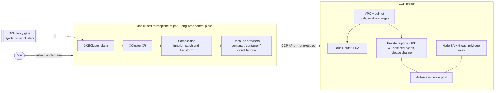

# kind-crossplain-gke-provision

Crossplane on kind provisioning a private regional GKE cluster (VPC, Cloud NAT, Workload Identity) via an `XCluster` claim; offline-verifiable, no GCP deploy.

A local **kind** cluster is the long-lived Crossplane control plane. A user creates a `GKECluster` claim; the `XCluster` composition turns it into a VPC, subnet with secondary ranges, Cloud Router + Cloud NAT, a least-privilege node service account, a **private regional GKE cluster** (private nodes + private endpoint, Workload Identity, shielded nodes, release channel) and a separate autoscaling node pool.

> **Status: nothing in this repo has been applied to GCP.** No GCP project, credentials, or API call is involved in development or CI. Everything is verified offline (lint, render, schema validation, policy). The real-GCP steps below are marked *not executed*.

## Architecture



Node SA roles: `logging.logWriter`, `monitoring.metricWriter`, `monitoring.viewer`, `artifactregistry.reader`.
The XRD only accepts `enablePrivateNodes: true` / `enablePrivateEndpoint: true`, and the OPA policy rejects them (and `0.0.0.0/0` authorized networks) earlier, in CI.

## Layout
| Path | Purpose |
|---|---|
| `bootstrap/` | kind config, `bootstrap.sh` (Crossplane via helm), pinned Providers/Functions, ProviderConfig **with placeholders** |
| `apis/xcluster/` | XRD (`XCluster`, claim `GKECluster`) and Composition |
| `examples/claim.yaml` | Example claim (placeholder project/region) |
| `policy/` | Rego policy + unit tests; `tests/policy/` negative fixture |
| `scripts/check.sh` | Runs every CI check locally |
| `docs/ci-design.md`, `docs/teardown.md` | CI design, teardown |

Pinned: Crossplane `1.20.14`, providers `provider-gcp-{compute,container,cloudplatform}` `v3.1.3`, `function-patch-and-transform` `v0.11.2`, `function-auto-ready` `v0.7.3`.

## Prerequisites
- Docker, [kind](https://kind.sigs.k8s.io/), kubectl, helm
- For the checks: yamllint, kubeconform, [opa](https://www.openpolicyagent.org/), [crossplane CLI v1.20.x](https://docs.crossplane.io/v1.20/cli/) (Docker is also needed by `crossplane render`)
- For real use only (later): a GCP project with billing, the Compute, Kubernetes Engine, IAM APIs enabled, and a credential that can create the resources above.

## Run manually

### 1. Offline verification (executed)
```bash
scripts/check.sh
```
Real output (abridged):
```
=== yamllint ===
=== kubeconform ===
Summary: 9 resources found in 4 files - Valid: 9, Invalid: 0, Errors: 0, Skipped: 0
=== render ===
render OK: 12 documents (Cluster x1 Network x1 NodePool x1 ProjectIAMMember x4 Router x1 RouterNAT x1 ServiceAccount x1 Subnetwork x1 XCluster x1 )
=== validate ===
Total 12 resources: 0 missing schemas, 12 success cases, 0 failure cases
=== policy ===
PASS: 7/7
policy: examples/claim.yaml -> 0 violations
policy: tests/policy/bad-public-claim.yaml -> 3 violations (rejected as expected)
ALL CHECKS PASSED
```
Run one stage with e.g. `scripts/check.sh policy`.

### 2. kind control plane + Crossplane (executed, partially)
Executed on this host: kind cluster creation, Crossplane 1.20.14 helm install, applying the XRD and Composition, and server-side dry-run of the claim. The GCP providers were **not** installed in that run (large CRD sets); `bootstrap.sh` as a whole was not run end to end.
```bash
kind create cluster --config bootstrap/kind-config.yaml --wait 120s
helm repo add crossplane-stable https://charts.crossplane.io/stable && helm repo update crossplane-stable
helm upgrade --install crossplane crossplane-stable/crossplane -n crossplane-system --create-namespace --version 1.20.14 --wait --timeout 5m
kubectl apply -f apis/xcluster/definition.yaml
kubectl wait --for=condition=Established xrd/xclusters.platform.example.org --timeout=2m
kubectl apply -f apis/xcluster/composition.yaml
kubectl apply --dry-run=server -f examples/claim.yaml
```
Observed:
```
compositeresourcedefinition.apiextensions.crossplane.io/xclusters.platform.example.org condition met
composition.apiextensions.crossplane.io/xclusters.gcp.platform.example.org created
gkecluster.platform.example.org/demo created (server dry run)
```
A claim with `enablePrivateEndpoint: false` is refused by the API server:
```
The GKECluster "demo" is invalid: spec.parameters.privateCluster.enablePrivateEndpoint: Unsupported value: false: supported values: "true"
```
Clean up: `kind delete cluster --name crossplane-mgmt`.

The all-in-one script (also installs the providers/functions in `bootstrap/providers.yaml`) is `bootstrap/bootstrap.sh` — *not executed end to end*.

### 3. Real GCP — *not executed - requires GCP project*
```bash
# a) Credentials (you supply; never commit). Method is your choice; example: service-account JSON key
kubectl create secret generic gcp-credentials -n crossplane-system --from-file=credentials=./gcp-credentials.json
# b) ProviderConfig with YOUR project ID
sed 's/REPLACE_WITH_GCP_PROJECT_ID/<your-project-id>/' bootstrap/providerconfig.yaml | kubectl apply -f -
# c) Claim with YOUR project + region (edit examples/claim.yaml first), after `scripts/check.sh policy`
kubectl apply -f examples/claim.yaml
kubectl get gkecluster,managed
```
Notes: the control-plane endpoint is private, so `kubectl` against the new GKE cluster needs a path into the VPC (bastion/IAP, Connect gateway, or a VPN) and `masterAuthorizedNetworks` covering it. Node-pool min/max are **per zone**. Keep claim names short: the node service account ID is `<name>-nodes` (GCP limit: 30 chars).

## Cost warning
Applying the claim creates billable GCP resources: a regional GKE cluster (control-plane fee, plus nodes across ~3 zones with a minimum of 1 node per zone), Cloud NAT (hourly + per-GB), NAT IPs, disks and logging/monitoring. Expect on the order of tens of USD per month at minimum even idle; check current GCP pricing. Delete when done (see below).

## Teardown
See [docs/teardown.md](docs/teardown.md). Short version: delete the claim, wait for `kubectl get managed` to be empty, *then* delete the kind cluster. Deleting kind first orphans billable GCP resources.

## Follow-up: pivoting to a management cluster (kind -> GKE)
A kind cluster on a laptop is a fragile long-lived control plane. A later step could be to host Crossplane on the GKE cluster this project creates (or another one). Risks to plan for:
- **Chicken-and-egg / lifecycle:** the cluster that would run Crossplane is itself managed by the kind Crossplane. Deleting its claim deletes its own management plane.
- **No built-in pivot:** unlike Cluster API's `clusterctl move`, Crossplane has no move command. You must re-create XRs/claims on the target and adopt existing GCP resources (matching `crossplane.io/external-name`, `managementPolicies: [Observe]` first, pause the source side) — a mistake can cause duplicate creates or deletes.
- **Split brain:** two Crossplanes reconciling the same resources will fight. Pause/delete the source ones with `deletionPolicy: Orphan` before cutover.
- **Private endpoint:** the in-cluster Crossplane only needs GCP APIs (fine), but you need a private path for `kubectl`/GitOps to reach it.
- **Credentials:** prefer Workload Identity on the target over long-lived keys; migrate the ProviderConfig deliberately.
- **State:** all desired state lives in etcd of whichever cluster is current. Keep claims in Git and back up before pivoting.

## Values you must supply later
GCP project ID, region, and a credential method (SA key Secret or Workload Identity Federation). They appear only as `REPLACE_WITH_*` placeholders in `bootstrap/providerconfig.yaml` and `examples/claim.yaml`.
